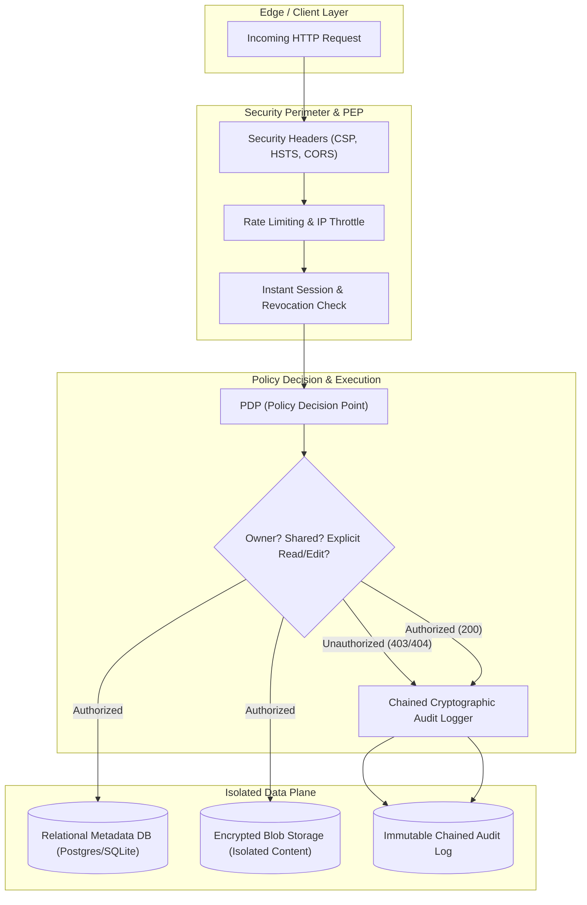

# Top 1% Secure Vault Engineering & Architecture (Zero-Trust)

This skill encapsulates the battle-tested design patterns, cryptographic foundations, and security invariants used by top 1% security architects and principal engineers to construct unassailable document vault systems.

---

## 🎯 Non-Negotiable Security Invariants

In high-assurance document vault systems (e.g., TrustVault), five non-negotiable security laws govern all system design:

1. **Law of Server-Side Exclusivity (No Client Trust):**
   No authorization decision may ever be delegated to or assumed by the client. UI visibility toggles are cosmetic only; the server must validate tenancy, role, and document-level permission on **every single request**, regardless of the route or verb.

2. **Law of Administrative Blindness (Zero-Knowledge Admin):**
   System Administrators possess infrastructure governance powers (user activation, role assignment, audit log monitoring), but have **zero intrinsic read or download access** to confidential documents unless explicitly shared by the Document Owner.

3. **Law of Instantaneous Revocation (Zero-Delay Permission Expiration):**
   Revoking a user's permission or deactivating an account must take effect at **\(T = 0\)**. No cached JWT claims or decoupled tokens may allow a single extra request once access has been struck.

4. **Law of Cryptographic Audit Immutability:**
   Every event (create, view, download, edit, share, revoke, delete, restore) and **every rejected/unauthorized access attempt** must be recorded in an immutable, cryptographic hash-chained ledger (`hash_i = HMAC_SHA256(hash_{i-1}, event_payload)`). Tampering with any historical entry invalidates the chain.

5. **Law of Invariant-Tested Authorization (Mutation Immunity):**
   The test suite must treat security as an active invariant. If an authorization guard or tenant check is commented out, the automated test suite must immediately fail.

---

## 🏛️ The 5 Pillars of Top 1% Vault Architecture



---

## 📋 Comprehensive Execution Runbook

### Phase 1: Zero-Trust Data Model & Schemas
* **Users Table:** ID, Email, Name, Role (`ADMIN`, `OWNER`, `VIEWER`), `isActive` (boolean), `permissionEpoch` (integer for instant token invalidation), `createdAt`.
* **Documents Table:** ID (UUID v4), Name, Description, Category, OwnerId (foreign key), StorageKey (randomized UUID, never exposed), MimeType, ByteSize, Version (int), IsDeleted (soft-delete flag), `createdAt`, `updatedAt`.
* **DocumentVersions Table:** ID, DocumentId, VersionNumber, StorageKey, ByteSize, UploadedById, `createdAt`.
* **DocumentPermissions Table:** ID, DocumentId, UserId, AccessLevel (`READ`, `EDIT`), GrantedById, `createdAt`, `updatedAt` (Unique on `[DocumentId, UserId]`).
* **AuditLogs Table:** ID, Timestamp, UserId (nullable for anonymous), UserEmail, Action, ResourceType, ResourceId, Outcome (`SUCCESS` / `DENIED`), Reason, ClientIP, UserAgent, PreviousHash, EntryHash.

### Phase 2: Centralized PDP / PEP (Policy Decision Point)
Top 1% systems decouple policy decisions from route handlers:
```typescript
export async function authorizeDocumentAccess(
  currentUser: SessionUser,
  documentId: string,
  requiredLevel: 'READ' | 'EDIT' | 'DELETE' | 'SHARE'
): Promise<AuthorizationResult> {
  // 1. Check if user is active
  if (!currentUser.isActive) return { authorized: false, reason: 'USER_DEACTIVATED' };

  // 2. Fetch document
  const doc = await db.document.findUnique({ where: { id: documentId } });
  if (!doc || doc.isDeleted) return { authorized: false, reason: 'DOCUMENT_NOT_FOUND' };

  // 3. Document Owner has full privileges
  if (doc.ownerId === currentUser.id) return { authorized: true, document: doc };

  // 4. Admins CANNOT read or download unless explicitly shared!
  if (requiredLevel === 'DELETE' || requiredLevel === 'SHARE') {
    // Only owner can delete or grant share permissions
    return { authorized: false, reason: 'OWNER_PRIVILEGE_REQUIRED' };
  }

  // 5. Check explicit permissions
  const perm = await db.documentPermission.findUnique({
    where: { documentId_userId: { documentId, userId: currentUser.id } }
  });
  if (!perm) return { authorized: false, reason: 'NO_EXPLICIT_PERMISSION' };

  if (requiredLevel === 'EDIT' && perm.accessLevel !== 'EDIT') {
    return { authorized: false, reason: 'READ_ONLY_PERMISSION' };
  }

  return { authorized: true, document: doc, accessLevel: perm.accessLevel };
}
```

### Phase 3: Defensive Upload & Magic Byte Sniffing
Never trust `req.file.mimetype` or file extensions.
1. Read the first 4–8 bytes of the uploaded buffer.
2. Validate file signatures:
   - PDF: `%PDF-` (`0x25, 0x50, 0x44, 0x46`)
   - PNG: `0x89, 0x50, 0x4E, 0x47, 0x0D, 0x0A, 0x1A, 0x0A`
   - JPEG: `0xFF, 0xD8, 0xFF`
   - Plain Text / Markdown: Validate UTF-8 compliance, zero null bytes (`0x00`).
3. Sanitize filename: Strip path separators, directory traversal sequences (`../`, `..\\`), and normalize.
4. Store in blob storage under a purely non-deterministic UUID (e.g. `storage/blobs/${uuidv4()}`).

### Phase 4: Cryptographic Hash-Chained Audit Trail
Every single audit entry links to the previous entry hash:
$$\text{EntryHash}_k = \text{HMAC-SHA256}(\text{Secret}, \text{EntryHash}_{k-1} \parallel \text{Timestamp} \parallel \text{UserId} \parallel \text{Action} \parallel \text{ResourceId} \parallel \text{Outcome})$$

If an attacker modifies a record in the database directly, running the chain verification utility detects the exact compromised row within milliseconds.

### Phase 5: Security Mutation & Invariant Testing
Write end-to-end integration tests that deliberately attempt unauthorized actions:
* Test IDOR: User B attempts to GET `/api/documents/:idOfUserA` -> Expect 404/403.
* Test Admin Blindness: Admin attempts to download private document of User A -> Expect 403.
* Test Editor Privilege Escalation: Editor attempts to POST `/api/documents/:id/permissions` -> Expect 403.
* Test Instant Revocation:
  1. User A grants Read to User B.
  2. User B fetches document -> 200 OK.
  3. User A revokes User B.
  4. User B immediately fetches document again -> 403 Denied.
* Test Audit Logging of Refused Attempts:
  - Verify that the failed attempt generated an audit entry with `Outcome: DENIED`.

---

## 📑 Required Deliverable Specifications

### 1. `THREATS.md` (STRIDE Threat Model)
Must document:
* Trust boundaries & Threat actors (Malicious Viewer, Compromised Admin, External Attacker).
* STRIDE threats with concrete mitigations:
  - **S**poofing: Session tampering, bearer token theft.
  - **T**ampering: Direct database file tampering, audit record editing.
  - **R**epudiation: Denying unauthorized file access or download.
  - **I**nformation Disclosure: IDOR enumeration, timing side-channels, search metadata leakage.
  - **D**enial of Service: Memory exhaustion via zip bombs, unbounded audit logs.
  - **E**levation of Privilege: Horizontal & vertical privilege escalation.
* Explicit list of Accepted Risks & Rationale.

### 2. `PROMPTS.md` (AI Oversight Ledger)
To score maximum marks in Snovasys evaluation:
* Maintain a chronological log with exact dates/times.
* Highlight specific instances where AI generated insecure or naive code (e.g., client-side checks, missing tenant filter, allowing Admin to view files, unvalidated file extensions).
* Document the human review, the architectural decision made, and the code fix applied.
