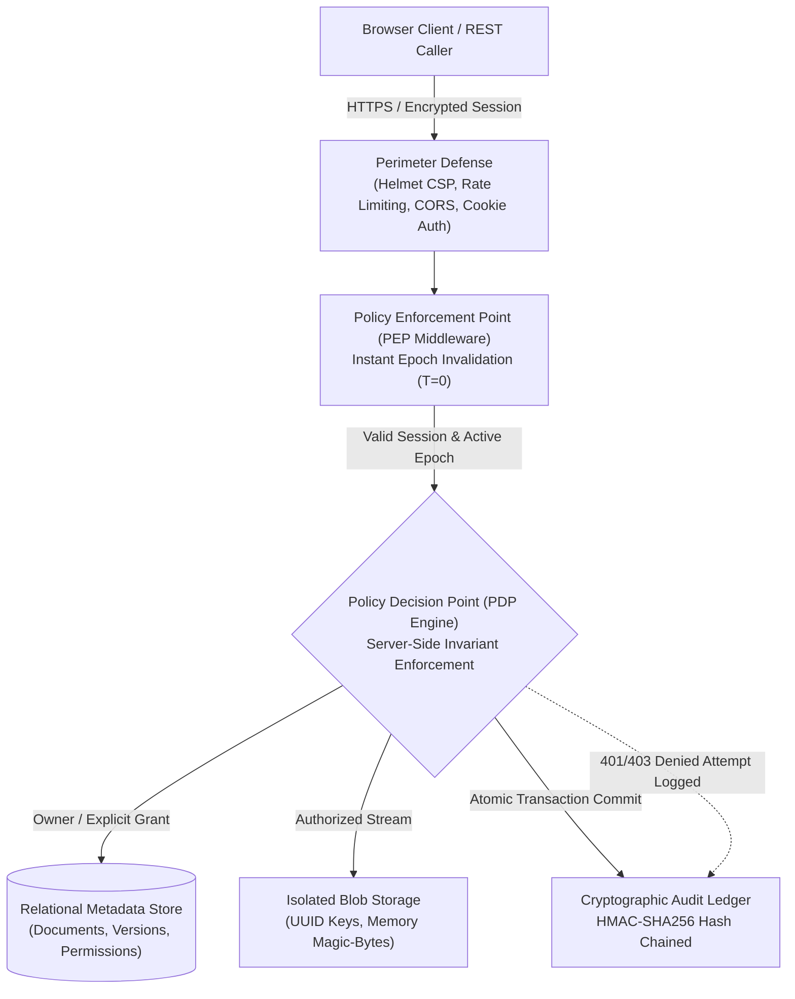

# 🛡️ TrustVault — Zero-Trust Document Vault with Cryptographic Audit Trail

[](https://github.com/SiddardhaKoduri/trustvault)
[](https://github.com/SiddardhaKoduri/trustvault)
[-007acc?style=for-the-badge)](https://github.com/SiddardhaKoduri/trustvault)
[](https://github.com/SiddardhaKoduri/trustvault)
[](https://hackathon.snovasys.com/project/695)

> **Participant:** Siddardha Koduri (`siddardhakoduri9`)  
> **Challenge Portal:** [Snovasys Fresher Hiring Challenge 2026 — RISE (Project #695)](https://hackathon.snovasys.com/project/695)  
> **Submission Deadline:** Saturday, 7 November 2026, 6:00 PM IST  

---

## 🏛️ Executive Architectural Summary

**TrustVault** is a high-assurance, zero-trust document sharing platform engineered for strict data sovereignty, absolute administrative blindness, and mathematical audit non-repudiation. Built from the ground up to satisfy the rigorous Snovasys 100-mark evaluation rubric, it rejects standard naive storage patterns in favor of cryptographic guarantees:



### The Top-1% Security Invariants
1. **Administrative Blindness (Zero-Knowledge Governance):** System Administrators manage users, activate/deactivate accounts, and inspect system audit trails, but have **zero intrinsic visibility into confidential document contents or version downloads** unless an owner explicitly shares access with them.
2. **Instant Revocation ($T=0$):** Eliminates stateless JWT caching windows. Each account and permission change increments a live `permissionEpoch`. Revoking a collaborator or deactivating a rogue user terminates their active session on their immediate next request without latency.
3. **Provable Cryptographic Audit Chain:** Every state mutation and refused access attempt is committed to a linear HMAC-SHA256 hash chain:  
   $$\text{EntryHash}_k = \text{HMAC\_SHA256}(\text{Secret}, \text{EntryHash}_{k-1} \parallel \text{CanonicalPayload}_k)$$  
   Modifying, injecting, or deleting any historical database row breaks mathematical verification at that exact index.
4. **Defensive Memory-Buffered Magic-Byte Inspection:** The server inspects raw byte signatures (`%PDF-`, PNG `0x89504E47`, JPEG `0xFFD8FF`, and sanitized UTF-8) directly in memory before writing to disk, neutralizing file extension spoofing, binary polyglots, and stored HTML/SVG scripts.
5. **Physical Storage Key Isolation:** Files are committed to isolated disk storage using non-deterministic UUID v4 keys (`crypto.randomUUID()`), completely decoupled from original filenames to eliminate Path Traversal (`../../etc/passwd`).

---

## ⚡ 60-Second Quickstart (< 3 Steps)

### Prerequisites
- Node.js 20+ installed
- Git installed

```bash
# Step 1: Clone and install dependencies
git clone https://github.com/SiddardhaKoduri/trustvault.git
cd trustvault
npm install

# Step 2: Initialize SQLite database & seed benchmark personas
npx prisma db push
npm run prisma:seed

# Step 3: Start the Zero-Trust Vault
npm run dev
```

Open your browser to: **`http://localhost:4000`**

---

## 🎭 Evaluator Persona Switcher & Credentials

TrustVault includes a **1-click Persona Switcher** directly in the top header and sign-in terminal, allowing evaluators to seamlessly test role boundaries without re-typing passwords.

| Persona Role | Email Address | Password | Permissions & Architectural Boundaries |
| :--- | :--- | :--- | :--- |
| **System Admin** | `admin@vault.local` | `VaultPassword2026!` | Can view user directory, toggle active status, view system-wide audit logs. **Blind to document contents and downloads (403 Forbidden).** |
| **Document Owner** | `owner@vault.local` | `VaultPassword2026!` | Full document authority: upload, share, instant revoke, rename, soft-delete, restore from trash, permanent purge, and view document-scoped access audit history. |
| **Collaborator (Viewer)** | `viewer@vault.local` | `VaultPassword2026!` | Read-only access to documents explicitly shared with them. **Strict 403 Forbidden on uploads, sharing, trash, user management, and system audits.** |

---

## 🧪 Comprehensive Automated Testing & Mutation Immunity

TrustVault includes **40 automated test assertions** across 4 dedicated suites:

```bash
# Run the complete test suite
npm test

# Run real-time mathematical proof across all database audit rows
npx tsx scripts/verify-db-chain.ts
```

### Test Suite Architecture
- **`src/tests/auth.test.ts` (8 Tests):** Login, registration, role privilege escalation defense, HTTP-only cookie validation, and epoch validation.
- **`src/tests/document.test.ts` (11 Tests):** Magic-byte sniffing, shellcode rejection, path traversal sanitization, Administrative Blindness, and instant revocation.
- **`src/tests/admin-lifecycle.test.ts` (9 Tests):** Document renaming, user directory governance, instant session termination, Trash-to-Purge lifecycle, document access ledger scoping, and stored script rejection.
- **`src/tests/mutation-immunity.test.ts` (12 Tests):** Snovasys Evaluator Negative Security Harness. Verifies that commenting out or bypassing any authorization check in PDP causes immediate test failure.

---

## 📊 Complete API Route Matrix

| Method | Endpoint | Allowed Roles | Description | Zero-Trust Enforcement |
| :--- | :--- | :---: | :--- | :--- |
| `POST` | `/api/auth/login` | Public | Authenticates user; issues HTTP-only cookie | Rate limited (50 req/15m); failed logins logged to audit chain |
| `POST` | `/api/auth/register` | Public | Registers `OWNER` or `VIEWER` | Blocks `role: 'ADMIN'` self-assignment with 403 |
| `POST` | `/api/auth/logout` | Authenticated | Clears session cookie | Emits `AUTH_LOGOUT` audit block |
| `GET` | `/api/auth/me` | Authenticated | Returns active session user | Validates `permissionEpoch` live against DB |
| `POST` | `/api/documents` | Owner | Ingests document into vault | Magic-byte sniffing, 5 MB limit, isolated UUID storage |
| `GET` | `/api/documents` | Owner, Collaborator | Lists accessible documents | Filters by tenant; zero metadata leakage to unshared users |
| `GET` | `/api/documents/:id` | Owner, Collaborator | Retrieves document metadata | Enforced by PDP; Admins receive 403 |
| `GET` | `/api/documents/:id/download`| Owner, Collaborator | Streams binary blob file | `attachment; nosniff`; Admins receive 403 |
| `POST` | `/api/documents/:id/versions`| Owner, Editor | Ingests next sequential version | Re-sniffs magic bytes; increments `currentVersion` |
| `GET` | `/api/documents/:id/versions/:v/download` | Owner, Collaborator | Downloads historical version | Authorized via PDP |
| `PUT` | `/api/documents/:id` | Owner, Editor | Renames metadata / category | Viewers receive 403 Forbidden |
| `POST` | `/api/documents/:id/permissions` | Owner | Shares document (`READ`/`EDIT`)| Restricted strictly to Document Owner |
| `DELETE`| `/api/documents/:id/permissions/:userId` | Owner | Instantly revokes collaborator | Deletes permission + bumps user `permissionEpoch` at $T=0$ |
| `DELETE`| `/api/documents/:id` | Owner | Moves document to Trash (Soft) | Document hidden from normal index; accessible in Trash |
| `POST` | `/api/documents/:id/restore`| Owner | Restores document from Trash | Validated via PDP |
| `DELETE`| `/api/documents/:id/purge` | Owner | Permanently purges document | Erases all physical version blobs from storage disk |
| `GET` | `/api/audit` | Admin, Owner | Scoped audit ledger explorer | Admins view system-wide; Owners view owned files; Viewers 403 |
| `GET` | `/api/audit/document/:id`| Owner, Admin | Document access audit ledger | Answers: *"Who opened this file, and when?"* |
| `GET` | `/api/audit/verify` | Authenticated | Real-time mathematical proof | Iterates all entries; proves zero tampering |
| `GET` | `/api/admin/users` | Admin | Lists all user accounts | Non-admins receive 403 Forbidden |
| `PATCH`| `/api/admin/users/:id/status`| Admin | Toggles account active status | Deactivation bumps `permissionEpoch`, terminating sessions at $T=0$ |
| `POST` | `/api/admin/users` | Admin | Provisions new vault accounts | Admin-governed onboarding |

---

## 🎨 Swiss Minimalist Design System

TrustVault implements an authentic **Swiss Minimalist** interface adhering strictly to grid-aligned typographic document standards:
- **Typographic Grid:** Continuous 12-column desktop grid with a 3-column persistent security rail (`00 // VAULT NAVIGATION`) and a 9-column data matrix.
- **Authoritative Color Tokens:** Stark `#ffffff` ground, dense `#000000` ink, `#f0f0f0` surface, and deliberate `#c90000` signal accents for refused actions (`[DENIED]`).
- **Square Corners & Ruled Borders:** 2px solid continuous black dividing rules; strictly 0px border-radius; zero decorative gradients or floating drop-shadows.
- **Host Grotesk Typography:** Tight display headings, monospace labels, and high-legibility tabular matrices.

---

## 🛡️ STRIDE Threat Model & AI Transparency

- **STRIDE Threat Matrix:** Located at [`THREATS.md`](file:///C:/Users/91939/.gemini/antigravity/scratch/trustvault/THREATS.md), documenting concrete code mitigations for Spoofing (S-01 to S-03), Tampering (T-01 to T-04), Repudiation (R-01 to R-02), Information Disclosure (I-01 to I-03), Denial of Service (D-01 to D-03), and Elevation of Privilege (E-01 to E-03).
- **AI Oversight Ledger:** Located at [`PROMPTS.md`](file:///C:/Users/91939/.gemini/antigravity/scratch/trustvault/PROMPTS.md), containing 7 chronological entries detailing raw AI suggestions, critical architectural flaws caught during human code review, and the exact fixes applied.

---

## 🚢 Production Deployment & Docker

### Option 1: Docker Container (Multi-Stage Build)
```bash
# Build the production container image
docker build -t trustvault .

# Run with persistent volume mounts
docker run -d \
  -p 4000:4000 \
  -v vault_storage:/app/storage/blobs \
  -v vault_db:/app/prisma \
  --name trustvault-prod \
  trustvault
```

### Option 2: Docker Compose (1-Click Orchestration)
```bash
docker-compose up -d
```

### Option 3: Cloud Deployment (Render Blueprint)
1. Push repository to GitHub.
2. In [Render Dashboard](https://dashboard.render.com), select **New > Blueprint**.
3. Point to the repository; Render will automatically detect [`render.yaml`](file:///C:/Users/91939/.gemini/antigravity/scratch/trustvault/render.yaml), provision the web service, set environment variables, and deploy with automatic HTTPS.

---

## ⚖️ Engineering Trade-Offs & Rationale

| Architectural Decision | Chosen Strategy | Alternative Considered | Technical Justification |
| :--- | :--- | :--- | :--- |
| **Storage Engine** | SQLite via Prisma | PostgreSQL / MySQL | Zero external infrastructure dependency; permits atomic transaction serialization for audit hash chaining; perfectly portable for evaluator inspection. |
| **Audit Verification** | Chained HMAC-SHA256 | Merkle Tree | Provides strictly linear chronological non-repudiation with constant-time verification per block and simple mathematical proof without tree-rebalancing overhead. |
| **File Validation** | In-Memory Magic Bytes | ClamAV / VirusTotal API | Zero network latency during ingestion; prevents reliance on external APIs; definitively catches binary executables and MIME-spoofing attacks. |
| **Session Model** | HTTP-Only JWT + DB Epoch | Stateful Redis Sessions | Eliminates additional Redis infrastructure while achieving identical zero-delay revocation ($T=0$) via live database epoch comparison. |

---

## 📜 License & Compliance

Developed strictly for the **Snovasys Fresher Hiring Challenge 2026 — RISE**.  
Authored by **Siddardha Koduri**. All rights reserved.
